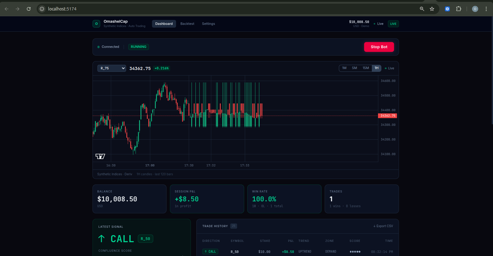

<div align="center">



<br/><br/>

# OmashelCap

**Automated algorithmic trading bot for Deriv synthetic indices**  
Real-time candlestick chart · Live signals · Risk management · Full-stack web dashboard

<br/>

[](https://python.org)
[](https://fastapi.tiangolo.com)
[](https://react.dev)
[](https://typescriptlang.org)
[](https://tailwindcss.com)
[](https://docs.astral.sh/uv/)
[](https://github.com/iamMashel/OmashelCap/actions)
[](LICENSE)
[](https://github.com/iamMashel/OmashelCap/stargazers)

</div>

---

## What is this?

OmashelCap is a production-grade algorithmic trading system for **Deriv synthetic indices** — markets that run 24/7, are immune to news events, and are powered by a cryptographically secure RNG.

It connects to Deriv's WebSocket API, streams live OHLC candles to a professional candlestick chart, scores trading signals using multi-factor confluence, manages risk with strict rules, and pushes everything live to a web dashboard — all in real time.

**Mock mode included** — runs fully without an API key so you can explore the full system immediately.

---

## Features

| | Feature | Detail |
|---|---|---|
| 📈 | **Live Price Chart** | Real-time candlestick chart (lightweight-charts v5) — R_75, R_50, CRASH/BOOM, 1M–1H timeframes |
| 🧠 | **Signal Engine** | Market structure · EMA alignment · RSI · Bollinger Bands · Supply & Demand zones |
| 🎯 | **Confluence Scoring** | 0–5 score — only fires when ≥ 3 conditions align simultaneously |
| ⚖️ | **Risk Management** | Fixed fractional sizing (1% per trade) · hard max stake cap · no Martingale |
| 🛑 | **Circuit Breaker** | Auto-halts after N consecutive losses or daily drawdown limit — restartable from UI |
| 🔄 | **Backtesting Engine** | Walk-forward bar-by-bar backtest on real Deriv historical candles — saved to DB |
| 📊 | **Backtest History** | Compare past runs: ROI · win rate · profit factor · drawdown · equity curve |
| ⚙️ | **Strategy Configurator** | Change symbol, timeframe, risk %, stakes, circuit breaker — live from dashboard |
| 📡 | **Telegram Alerts** | Trade open/close, circuit breaker events, startup notifications |
| 🗄️ | **Trade Logging** | Every trade logged to SQLite with full signal context |
| 🧪 | **Mock Mode** | Full simulation — no API key needed |
| 🐳 | **Docker Ready** | API + frontend containerised with docker-compose |

---

## Dashboard

The dashboard has three tabs:

### Dashboard tab
- Live candlestick chart (symbol + timeframe selector, live price, % change)
- Bot controls (Start / Stop / Reset & Start after circuit breaker)
- Balance · Session P&L · Win Rate · Total Trades stat cards
- Latest signal panel with confluence score and reason
- Full trade history table with CSV export

### Backtest tab
- Configure symbol, timeframe, candle count, trade duration, min score, starting balance
- Run walk-forward backtest on real Deriv historical data
- View metrics: ROI, win rate, profit factor, expectancy, max drawdown, best/worst trade
- Equity curve chart
- Full run history table — compare across sessions

### Settings tab
- Live-editable strategy configuration
- PATCH to API on save — no restart required

---

## Architecture

```
┌────────────────────────────────────────────────────────────┐
│                     Browser Dashboard                       │
│   React 19 · TypeScript · Tailwind v4 · Zustand · Vite     │
│   Dashboard tab │ Backtest tab │ Settings tab               │
└──────────────────────────┬─────────────────────────────────┘
                           │  WebSocket  +  REST
┌──────────────────────────▼─────────────────────────────────┐
│                    FastAPI (API Layer)                       │
│  /api/bot  /api/trades  /api/signals  /api/backtest         │
│  /api/settings  /ws/live  /ws/chart                         │
└──────────────────────────┬─────────────────────────────────┘
                           │
         ┌─────────────────┴──────────────────┐
         │                                    │
┌────────▼────────┐                 ┌─────────▼────────┐
│   Bot Engine    │                 │  Backtest Engine  │
│  DerivClient    │                 │  Walk-forward     │
│  DataFeed       │                 │  bar-by-bar sim   │
│  SignalEngine   │                 │  GBM fallback     │
│  RiskManager    │                 └─────────┬────────┘
│  OrderManager   │                           │
└────────┬────────┘                           │
         │                                    │
┌────────▼────────────────────────────────────▼────────┐
│               Deriv WebSocket API (wss://)             │
│          Synthetic Indices — 24/7 live markets         │
└───────────────────────────────────────────────────────┘
```

---

## Stack

| Layer | Technology |
|---|---|
| Bot engine | Python 3.12 · asyncio · websockets |
| API server | FastAPI · Uvicorn · WebSocket |
| Chart | [lightweight-charts v5](https://github.com/tradingview/lightweight-charts) (TradingView) |
| Dashboard | React 19 · TypeScript · Vite · Tailwind CSS v4 |
| State | Zustand · TanStack Query |
| Database | SQLite (dev) → PostgreSQL (prod) |
| Python packages | [uv](https://docs.astral.sh/uv/) |
| Node packages | pnpm |
| Containers | Docker · docker-compose |
| CI | GitHub Actions (ruff lint · mypy typecheck · pytest) |
| Pre-commit | ruff lint + format on every commit |

---

## Quick Start

### Mock mode — no API key needed

```bash
# 1. Clone
git clone https://github.com/iamMashel/OmashelCap.git
cd OmashelCap

# 2. Environment
cp .env.example .env          # USE_MOCK=true by default

# 3. Python dependencies
uv sync

# 4. Frontend dependencies
cd frontend && pnpm install && cd ..

# 5. Start API  (Terminal 1)
uv run uvicorn api.main:app --reload --port 9000

# 6. Start dashboard  (Terminal 2)
cd frontend && pnpm dev
```

Open **http://localhost:5173** → click **Start Bot** — live mock signals, trades and chart data start flowing immediately.

---

### Live trading setup

> ⚠️ **Always start on a demo account. Never risk money you haven't tested.**

1. Create a free account at [deriv.com](https://deriv.com)
2. Go to **[app.deriv.com/account/api-token](https://app.deriv.com/account/api-token)**
   - Create a token with `Read` + `Trade` scopes
   - Copy it — you only see it once
3. Edit `.env`:

```env
USE_MOCK=false
DERIV_APP_ID=36544            # public Deriv WebSocket app ID
DERIV_API_TOKEN=your_token    # from step 2
TRADING_MODE=demo             # keep on demo until confident
SYMBOL=R_75                   # Volatility 75 Index
RISK_PER_TRADE=0.01           # 1% of balance per trade
MAX_STAKE=10.00               # hard ceiling — never exceeded
MAX_CONSECUTIVE_LOSSES=5      # circuit breaker threshold
DAILY_DRAWDOWN_LIMIT=0.05     # 5% daily loss limit
```

---

## Signal Engine

The strategy scores each potential trade on 5 conditions. It only enters when **3 or more align**:

| Score point | CALL (long) | PUT (short) |
|---|---|---|
| Market structure | Higher Highs + Higher Lows | Lower Highs + Lower Lows |
| EMA alignment | EMA9 > EMA21 > EMA50 | EMA9 < EMA21 < EMA50 |
| RSI | < 35 (oversold) | > 65 (overbought) |
| S&D Zone | Price at demand zone | Price at supply zone |
| Bollinger Bands | Price at lower band | Price at upper band |

Signals are logged with their full context (score, trend, zone, RSI, reason) so every trade is explainable and auditable.

---

## Risk Rules

| Rule | Default |
|---|---|
| Stake per trade | 1% of account balance |
| Minimum stake | $0.35 |
| Maximum stake | $10.00 (hard cap) |
| Circuit breaker — consecutive losses | Halt after 5 |
| Circuit breaker — daily drawdown | Halt at 5% from day-open balance |
| Recovery | Fixed fractional only — **no Martingale, no averaging** |
| Manual reset | "Reset & Start" button in dashboard |

---

## Backtesting

Run the built-in backtester from the **Backtest tab** in the dashboard or via the API directly:

```bash
curl -X POST http://localhost:9000/api/backtest/run \
  -H "Content-Type: application/json" \
  -d '{
    "symbol": "R_75",
    "granularity": 60,
    "count": 2000,
    "trade_duration_bars": 5,
    "starting_balance": 1000,
    "min_score": 3
  }'
```

Results are saved to SQLite and can be retrieved via `GET /api/backtest/history`. The engine:
- Fetches real candles from Deriv (`ticks_history`) — falls back to GBM synthetic candles if offline
- Uses a walk-forward, bar-by-bar simulation — no lookahead bias
- Detects swing highs/lows using a trailing window
- Prevents overlapping trades
- Reports: win rate · ROI · profit factor · expectancy · max drawdown · equity curve

---

## Project Structure

```
OmashelCap/
│
├── core/               WebSocket client, session auth, message router
├── data/               Tick/candle models, rolling data store, feed subscriptions
├── analysis/           Indicators, market structure, supply/demand zones, scoring
├── risk/               Fixed fractional sizing, circuit breaker
├── trading/            Order lifecycle (proposal → buy → monitor), trade tracker
├── strategies/         Pluggable strategy interface + StructureConfluence v1
├── backtest/           Walk-forward engine + Deriv historical data fetcher
├── mock/               Mock bot — simulates real bot behaviour for development
│
├── api/                FastAPI — REST + WebSocket
│   └── routers/        bot · trades · signals · backtest · settings
│
├── frontend/           React dashboard
│   └── src/
│       ├── components/ PriceChart · BotControls · SignalPanel · TradeHistory
│       │               BacktestPanel · StrategyConfig · StatCard
│       ├── hooks/      useWebSocket (auto-reconnecting)
│       └── store/      Zustand bot state
│
├── storage/            SQLite trade + backtest logger
├── notify/             Telegram alerts
├── tests/              pytest suite
│
├── docs/               Screenshots and assets
├── docker-compose.yml
├── Dockerfile.api
├── .env.example        ← copy this to .env
└── .pre-commit-config.yaml
```

---

## Telegram Alerts

| Event | What's sent |
|---|---|
| Bot started | Balance · symbol · mode · risk settings |
| Trade opened | Direction · symbol · stake · confluence score · reason |
| Trade closed | P&L · balance · win rate · session P&L |
| Circuit breaker | Reason + manual review prompt |

**Setup:**
1. Message [@BotFather](https://t.me/BotFather) → `/newbot` → copy the token
2. Get your chat ID:
   ```bash
   curl "https://api.telegram.org/bot<TOKEN>/getUpdates"
   ```
3. Add to `.env`:
   ```env
   TELEGRAM_BOT_TOKEN=your_bot_token
   TELEGRAM_CHAT_ID=your_chat_id
   ```

---

## Running Tests

```bash
uv run pytest tests/ -v
```

```
tests/test_risk.py::test_stake_is_1_percent_of_balance   PASSED
tests/test_risk.py::test_stake_capped_at_max             PASSED
tests/test_risk.py::test_stake_minimum_enforced          PASSED
tests/test_risk.py::test_circuit_breaker_trips_on_max    PASSED
tests/test_risk.py::test_circuit_breaker_resets_on_win   PASSED
tests/test_risk.py::test_daily_drawdown_trips_circuit    PASSED
tests/test_structure.py::test_uptrend_detected           PASSED
tests/test_structure.py::test_ema_uptrend                PASSED
8 passed in 0.62s
```

---

## Docker

```bash
cp .env.example .env     # fill in credentials
docker-compose up --build
```

Dashboard → `http://localhost:5173`  
API → `http://localhost:9000`

---

## Roadmap

- [x] Live WebSocket candlestick price chart
- [x] Walk-forward backtesting engine on real Deriv candles
- [x] Backtest history — compare runs, equity curves
- [x] Strategy configurator UI
- [x] Circuit breaker with restartable UI
- [x] Pre-commit hooks (ruff lint + format)
- [ ] Crash/Boom spike detection strategy
- [ ] PostgreSQL migration for production
- [ ] Telegram signal-only mode (no auto-trade)
- [ ] Multi-symbol simultaneous trading
- [ ] ML regime detection (trending vs ranging)
- [ ] Mobile app (React Native)

---

## Risk Disclaimer

Synthetic indices are generated by a cryptographically secure RNG. Binary options have a structural house edge — at 85% payout you need a **> 54% win rate just to break even**. Past backtest performance does not guarantee future results.

**Never trade with money you cannot afford to lose entirely. Always validate on a demo account first.**

---

## License

MIT © [Mashel Odera](https://github.com/iamMashel)

---

<div align="center">

If this project is useful to you, consider giving it a ⭐ — it helps others find it.

</div>
